# Drift

The car that runs `sketches/drift` steers with a hobby servo and drives with a forward/reverse car ESC, both on 50 Hz
pulses, from a Bluetooth gamepad. An MPU6050 measures how fast the car spins, and the sketch adds counter-steer
against that spin, as an RC drift gyro does: when the tail swings out, the wheels turn into the slide, which damps the
spin so the car holds the drift. The gyro acts on the steering only; the throttle stays with the driver.

## Wiring

| GPIO | To | Setting |
| --- | --- | --- |
| 21 | ESC signal | `DRIFT_ESC_PIN` |
| 23 | Steering servo signal | `DRIFT_STEERING_PIN` |
| 27 | MPU6050 SDA | `DRIFT_I2C_SDA_PIN` |
| 26 | MPU6050 SCL | `DRIFT_I2C_SCL_PIN` |
| 2 | The board's LED | |

Each pin but the LED's is a `#define` that `local.h` can change, as [Setting it up for a car](#setting-it-up-for-a-car)
says. GPIO12 is not one to pick for SDA: it sets the flash voltage at reset, and an MPU6050 breakout's pull-up on SDA
holds it high, which selects 1.8 V and the board does not boot.

The MPU6050 lies flat, so its Z axis points up and its Z rate is the car's yaw rate.

## Controls

- **Left stick, sideways**: steering. A deflection under 40 of 512 counts as centred.
- **Right stick, up and down**: up drives forward; down brakes, then reverses, as the ESC does it. The throttle
  follows how far the stick is pushed, through the `DRIFT_THROTTLE_EXPO` curve, with the same dead zone as the
  steering.
- **D-pad up and down**: the gyro's gain, in steps of 0.1 from 0 to 1. Each change prints `gain <value>` on the
  serial port at 115200 baud.

The first gamepad to connect drives the car; the car forgets paired gamepads at every boot.

## Status LED

The board's LED stays lit while a gamepad is connected and the MPU6050 works. Otherwise it blinks once a second:

| LED | Means |
| --- | --- |
| Steady | Gamepad connected, MPU6050 working |
| Short blink, 150 ms | MPU6050 not found at boot, or its last read failed |
| Long blink, 600 ms | No gamepad connected |
| Short and long blinks alternating | Neither |

The MPU6050 is read only while a gamepad drives the car, so a sensor that stops answering shows only once a gamepad
is connected.

## Serial log

The sketch writes to the serial port at 115200 baud, between Bluepad32's own lines:

| Line | When |
| --- | --- |
| `gamepad <n> connected: <model>, vid <vid> pid <pid>, <address>` | A gamepad connects and drives the car. `ignored, another drives` instead of `connected` means a second gamepad connected and does not drive. |
| `gamepad <n> disconnected: …` | That gamepad disconnects. |
| `status gamepad connected\|missing, imu working\|failed` | Either changes; the LED shows the same. |
| `input lx … ry … dpad … buttons … battery … \| yaw … steer … esc …` | Every `DRIFT_LOG_INPUT_MS` while a gamepad drives: the raw left stick X and right stick Y, from -511 to 512 with down positive, the D-pad, buttons and battery, then the yaw rate in °/s and the steering and throttle sent, each -1 to 1. |
| `gain <value>` | At boot and at each gain change. |

The car must stand still while it boots: the sketch measures the gyro's bias then, for about a second. The ESC gets
the neutral pulse from power-on, which it needs to arm, so the motor stays stopped until the right stick moves.
Without an MPU6050 the car boots, prints `error MPU6050 not found, steering without assist` and drives as plain RC.

## Setting it up for a car

Each setting is a `#define` in `sketches/drift/local.h`, which Git ignores; the defaults are in
`sketches/drift/config.h`.

| Setting | Default | What it sets |
| --- | --- | --- |
| `DRIFT_STEERING_LEFT_US`, `_CENTER_US`, `_RIGHT_US` | 1000, 1500, 2000 | The servo pulses at full left, straight ahead and full right. Set them to where the car's steering stops, so the servo never stalls against them. |
| `DRIFT_THROTTLE_MAX` | 0.5 | The largest throttle the right stick reaches, as a fraction of the ESC's range each way. |
| `DRIFT_THROTTLE_EXPO` | 0.67 | The throttle's expo, 0 to 1: the throttle is (1 − expo) × stick + expo × stick³ of `DRIFT_THROTTLE_MAX`, so half stick gives about a quarter at 0.67. |
| `DRIFT_GAIN` | 0 | The gain at boot. |
| `DRIFT_FULL_LOCK_DPS` | 200 | The yaw rate, in °/s, at which a gain of 1 alone steers to full lock. |
| `DRIFT_GYRO_REVERSED` | 0 | 1 flips the counter-steer, for a sensor mounted upside down. |
| `DRIFT_LOG_INPUT_MS` | 250 | How often, in ms, the input line is written while a gamepad drives; 0 turns it off. |

To check the counter-steer's direction: with the car lifted, raise the gain to 0.5 and turn the car clockwise by hand,
seen from above. The front wheels must turn left. If they turn right, set `DRIFT_GYRO_REVERSED` to 1.

## Not handled

- A gamepad whose Bluetooth link stalls keeps counting as connected until Bluepad32 reports the disconnect, which can
  take several seconds; until then the car drives on its last command. Cut the ESC's power to stop it.
- The MPU6050 reads at most 250 °/s, so a faster spin counts as 250 °/s and gets less counter-steer than it calls
  for.
- The gain resets to `DRIFT_GAIN` at every boot.
